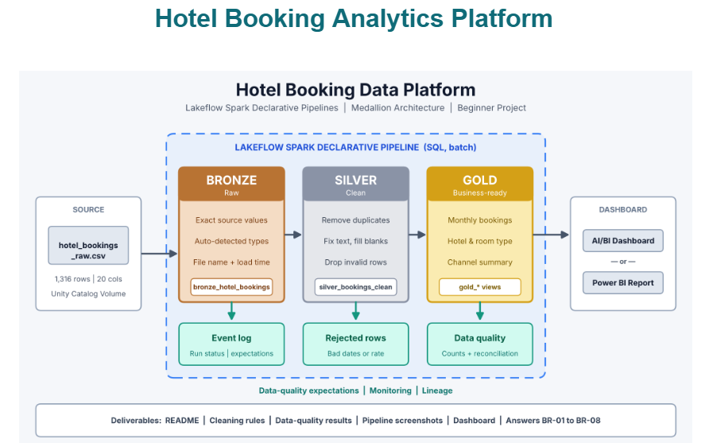
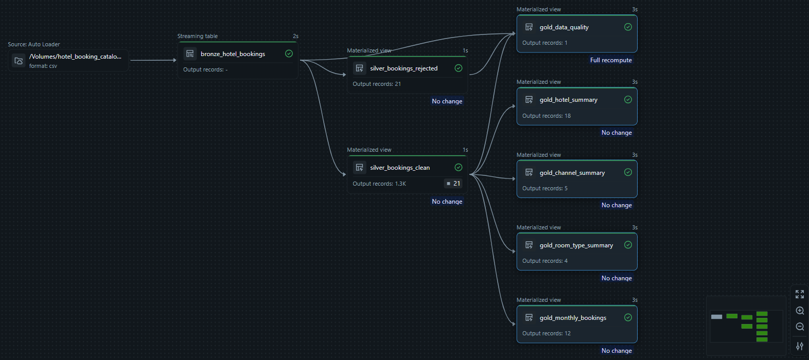

# Hotel Booking Analytics Platform: Medallion Architecture with Lakeflow Spark Declarative Pipelines

An end-to-end hotel booking ETL pipeline built using Azure Databricks, Lakeflow Spark Declarative Pipelines (SQL), and Medallion Architecture (Bronze → Silver → Gold).

It transforms raw hotel booking data into clean, business-ready tables with data quality checks, reconciliation, and dashboard reporting.

## Architecture



## Table of Contents

- [Business Problem](#business-problem)
- [Architecture](#architecture)
- [Pipeline Lineage](#pipeline-lineage)
- [Tech Stack](#tech-stack)
- [Dataset](#dataset)
- [Repository Structure](#repository-structure)
- [Layer Details](#layer-details)
- [Data Quality Rules](#data-quality-rules)
- [Reconciliation](#reconciliation)
- [How to Run](#how-to-run)
- [Business Requirements Coverage](#business-requirements-coverage)
- [Key Learnings](#key-learnings)
- [Future Improvements](#future-improvements)

## Business Problem

Hotel booking data contains duplicate records, missing values, extra spaces, inconsistent text, and invalid booking dates.

These issues affect booking reports, cancellation analysis, and revenue calculations.

**Goal:** Build a repeatable pipeline to clean and validate booking data and generate reliable business reports.

## Architecture

The project follows three layers:

| Layer | Purpose |
|---|---|
| Bronze | Store raw booking data |
| Silver | Clean data and separate rejected records |
| Gold | Create business-ready summary tables |

## Pipeline Lineage



| Table | Description |
|---|---|
| `bronze_hotel_bookings` | Raw booking records |
| `silver_bookings_clean` | Cleaned records |
| `silver_bookings_rejected` | Rejected records |
| `gold_monthly_bookings` | Monthly booking and revenue analysis |
| `gold_hotel_summary` | Hotel performance |
| `gold_room_type_summary` | Room type analysis |
| `gold_channel_summary` | Booking channel analysis |
| `gold_data_quality` | Data quality and reconciliation results |

## Tech Stack

- Azure Databricks
- Lakeflow Spark Declarative Pipelines (SQL)
- Unity Catalog Volumes
- Delta Lake
- Databricks SQL
- Databricks AI/BI Dashboard

## Dataset

- **Dataset:** Hotel Booking Dataset
- **File:** `hotel_bookings_raw.csv`
- **Size:** 1,316 rows × 20 columns

Contains booking IDs, hotel details, customer information, booking dates, room types, booking channels, booking status, and revenue details.

## Repository Structure

```text
Hotel_Booking_Analytics/
│
├── data/
│
├── docs/
│
├── ETL_Pipeline/
│   ├── Hotel_Bronze_Layer/
│   │   └── Bronze_Bookings/
│   │       └── Bronze_transformation.sql
│   │
│   ├── Hotel_Gold_Layer/
│   │   └── Gold_Bookings/
│   │       └── Gold_transformation.sql
│   │
│   └── Hotel_Silver_Layer/
│       └── Silver_Bookings/
│           └── Silver_transformation.sql
│
├── Images/
│   ├── architecture.png
│   └── pipeline_lineage.png
│
└── README.md
```

## Layer Details

**Bronze**
- Reads the CSV file from Unity Catalog Volume.
- Preserves original booking records.

**Silver**
- Removes duplicate records.
- Trims spaces and standardizes text.
- Validates required fields and booking dates.
- Separates clean and rejected records.

**Gold**
- Creates monthly booking summaries.
- Analyzes hotel performance.
- Analyzes room types and booking channels.
- Generates data quality results.

## Data Quality Rules

| Issue | Treatment |
|---|---|
| Duplicate booking IDs | Remove extra duplicates |
| Extra spaces and mixed case | Standardize text |
| Blank city or booking channel | Reject records |
| Missing nights | Reject records |
| Missing total amount | Reject records |
| Check-out before check-in | Reject records |
| Cancelled bookings | Retain as valid records |

Cancelled bookings are retained because they are valid business records.

## Reconciliation

Reconciliation checks whether Bronze records are accounted for in Silver.

**Formula:**

`Bronze Records - Duplicate Extra Rows = Clean Records + Rejected Records`

| Check | Result |
|---|---:|
| Bronze Records | 1,316 |
| Duplicate Extra Rows | 26 |
| Clean Records | 1,269 |
| Rejected Records | 21 |
| Actual Silver Records | 1,290 |
| Difference | 0 |

## How to Run

- Upload the CSV file to a Unity Catalog Volume.
- Set the target catalog and schema.
- Create a Lakeflow Spark Declarative Pipeline.
- Add the Bronze, Silver, and Gold SQL files.
- Run the pipeline.
- Verify the generated tables.
- Check `gold_data_quality` for reconciliation.
- Create the dashboard using Gold tables.

## Business Requirements Coverage

| ID | Requirement | Implementation |
|---|---|---|
| BR-01 | Monthly booking analysis | `gold_monthly_bookings` |
| BR-02 | Hotel performance | `gold_hotel_summary` |
| BR-03 | Room type analysis | `gold_room_type_summary` |
| BR-04 | Booking channel analysis | `gold_channel_summary` |
| BR-05 | Data quality monitoring | `gold_data_quality` |
| BR-06 | Reconciliation | Bronze and Silver comparison |
| BR-07 | Business reporting | Databricks AI/BI Dashboard |

**Dashboard Pages:**
- Dashboard-Overview
- Dashboard-Hotels_Rooms_and_Channels
- Dashboard-Quality

## Key Learnings

- Medallion Architecture.
- ETL pipeline development using Databricks SQL.
- Data cleaning and validation.
- Duplicate and rejected record handling.
- Data reconciliation.
- Gold table creation and dashboard reporting.
