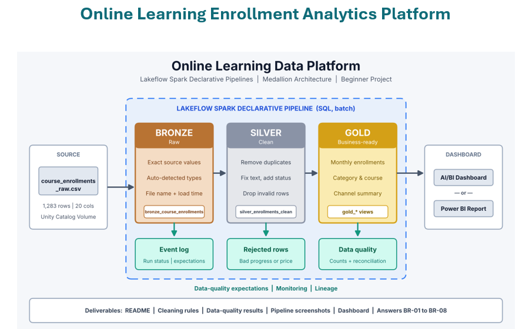
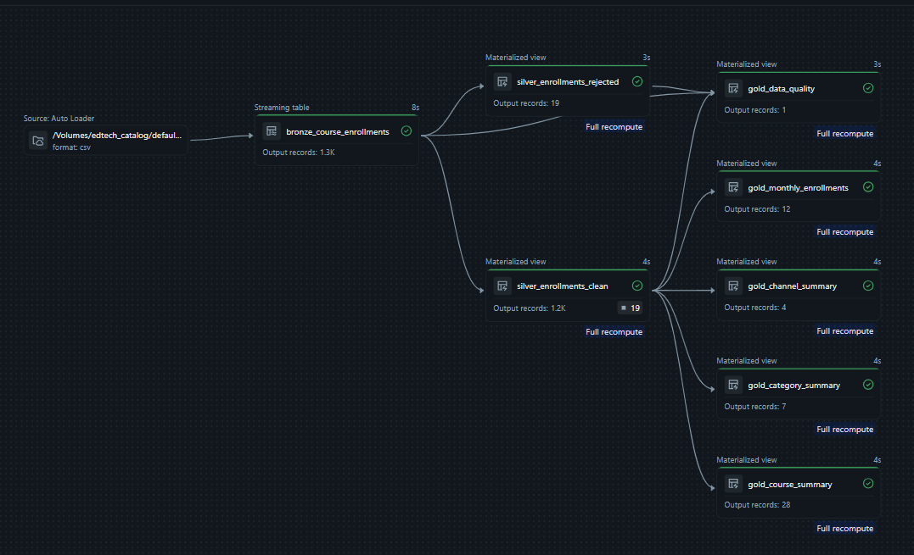

# Online Learning Enrollment Analytics Platform: Medallion Architecture with Lakeflow Spark Declarative Pipelines

An end-to-end online learning analytics ETL pipeline built using Azure Databricks, Databricks SQL, Auto Loader, and Medallion Architecture (Bronze → Silver → Gold).

It transforms raw course enrollment data into clean, business-ready tables with data quality checks, duplicate detection, email normalization, reconciliation, and dashboard reporting.

## Architecture


## Table of Contents

- [Business Problem](#business-problem)
- [Architecture](#architecture)
- [Pipeline Lineage](#pipeline-lineage)
- [Tech Stack](#tech-stack)
- [Dataset](#dataset)
- [Repository Structure](#repository-structure)
- [Layer Details](#layer-details)
- [Data Quality Rules](#data-quality-rules)
- [Reconciliation](#reconciliation)
- [How to Run](#how-to-run)
- [Business Requirements Coverage](#business-requirements-coverage)
- [Key Learnings](#key-learnings)
- [Future Improvements](#future-improvements)

## Business Problem

Online learning platforms generate enrollment data containing learner information, course details, payment records, learning progress, and enrollment channels.

However, raw enrollment data may contain duplicate records, missing values, inconsistent email formats, extra spaces, inconsistent category names, and invalid progress or payment values.

These issues affect learner counts, revenue calculations, course completion analysis, and dashboard reporting.

**Goal:** Build a repeatable data pipeline to clean and validate enrollment data and generate reliable business reports.

## Architecture

The project follows three layers:

| **Layer** | **Purpose**                                     |
| --------- | ----------------------------------------------- |
| Bronze    | Store raw enrollment data                       |
| Silver    | Clean data and separate rejected records        |
| Gold      | Create business-ready analytical summary tables |

## Pipeline Lineage



| **Table**                     | **Description**                             |
| ----------------------------- | ------------------------------------------- |
| `bronze_course_enrollments`   | Raw enrollment records                      |
| `silver_enrollments_clean`    | Cleaned and validated enrollment records    |
| `silver_enrollments_rejected` | Records rejected due to data quality issues |
| `gold_monthly_enrollments`    | Monthly enrollment and revenue analysis     |
| `gold_category_summary`       | Course category analysis                    |
| `gold_course_summary`         | Course performance analysis                 |
| `gold_channel_summary`        | Enrollment channel analysis                 |
| `gold_data_quality`           | Data quality and reconciliation results     |

## Tech Stack

- Azure Databricks
- Lakeflow Spark Declarative Pipelines(SQL)
- Unity Catalog Volumes
- Delta Lake
- Databricks SQL
- Databricks AI/BI Dashboards

## Dataset

- **Dataset:** Online Learning Enrollment Dataset
- **File:** course_enrollments_raw.csv
- **Size:** 1,283 rows × 20 columns

Contains enrollment IDs, learner details, course information, category, course level, instructor details, enrollment channel, pricing information, payment method, progress percentage, hours watched, and learner ratings.

## Repository Structure

```text
Online_Learning_Enrollments_Analytics/
│
├── data/
│
├── docs/
│
├── ETL_Pipeline/
│   ├── Learning_Bronze_Layer/
│   │   └── Bronze_Enrollments/
│   │       └── Bronze_transformation.sql
│   │
│   ├── Learning_Silver_Layer/
│   │   └── Silver_Enrollments/
│   │       └── Silver_transformation.sql
│   │
│   └── Learning_Gold_Layer/
│       └── Gold_Enrollments/
│           └── Gold_transformation.sql
│
├── Images/
│   ├── architecture.png
│   ├── bronze_pipeline.png
│   ├── Dashboard-Courses_and_Channels.png
│   ├── Dashboard-Data_Quality.png
│   ├── Dashboard-Overview.png
│   ├── Pipeline_graph.png
│   ├── silver_pipeline.png
│   └── workspace_structure.png
│
└── README.md
```

## Layer Details

**Bronze**

- Reads CSV files from Unity Catalog Volume using Auto Loader.
- Incrementally ingests new files.
- Preserves original enrollment records.
- Captures source file information.
- Records ingestion timestamps.

**Silver**

- Removes duplicate enrollment records using `enrollment_id`.
- Normalizes learner email addresses using `LOWER()` and `TRIM()`.
- Standardizes category names using `INITCAP()`.
- Validates progress percentages between 0 and 100.
- Identifies negative and missing payment values.
- Validates required enrollment fields.
- Separates clean and rejected records.

**Gold**

- Creates monthly enrollment and revenue summaries.
- Analyzes revenue and completion rates by category.
- Analyzes course performance and ratings.
- Analyzes enrollment and revenue by channel.
- Generates data quality and reconciliation results.

## Data Quality Rules

| **Issue**                   | **Treatment**                        |
| --------------------------- | ------------------------------------ |
| Duplicate enrollment IDs    | Remove extra duplicate records       |
| Extra spaces in text        | Standardize using `TRIM()`           |
| Mixed-case learner emails   | Normalize using `LOWER()`            |
| Inconsistent category names | Standardize using `INITCAP()`        |
| Missing enrollment ID       | Reject records                       |
| Invalid progress percentage | Reject values outside 0–100          |
| Negative price paid         | Reject records                       |
| Missing price paid          | Reject records                       |
| Missing category            | Reject records                       |
| Missing learner city        | Reject records                       |
| Missing learner email       | Handle according to validation rules |
| Missing rating              | Retain as `NULL`                     |
| Course progress of 0 or 100 | Retain as valid values               |

## Reconciliation

Reconciliation verifies whether Bronze records are properly accounted for in the Silver layer after duplicate removal and data quality validation.

**Formula:**

`Bronze Records - Duplicate Extra Rows = Clean Records + Rejected Records`

The reconciliation check helps ensure that records are neither lost nor incorrectly counted during data processing.

| **Check**             | **Result**                              |
| --------------------- | --------------------------------------- |
| Bronze Records        | From `gold_data_quality`                |
| Duplicate Extra Rows  | From duplicate enrollment ID validation |
| Clean Records         | From `silver_enrollments_clean`         |
| Rejected Records      | From `silver_enrollments_rejected`      |
| Actual Silver Records | Clean Records + Rejected Records        |
| Difference            | 0 when reconciliation passes            |

## How to Run

- Upload the enrollment CSV files to a Unity Catalog Volume.
- Set the target catalog and schema.
- Create the Bronze, Silver, and Gold SQL transformations.
- Configure the Bronze ingestion using Auto Loader.
- Run the data processing pipeline.
- Verify the generated Bronze, Silver, and Gold tables.
- Check `gold_data_quality` for data quality metrics and reconciliation.
- Create the dashboard using Gold tables.
- Validate the dashboard metrics against SQL query results.

## Business Requirements Coverage

| **ID** | **Requirement**             | **Implementation**           |
| ------ | --------------------------- | ---------------------------- |
| BR-01  | Monthly enrollment analysis | `gold_monthly_enrollments`   |
| BR-02  | Category revenue analysis   | `gold_category_summary`      |
| BR-03  | Course performance analysis | `gold_course_summary`        |
| BR-04  | Enrollment channel analysis | `gold_channel_summary`       |
| BR-05  | Data quality monitoring     | `gold_data_quality`          |
| BR-06  | Duplicate detection         | Enrollment ID validation     |
| BR-07  | Email normalization         | Silver transformation        |
| BR-08  | Reconciliation              | Bronze and Silver comparison |
| BR-09  | Business reporting          | Databricks AI/BI Dashboard   |

**Dashboard Pages:**

- Dashboard-Overview
- Dashboard-Courses_and_Channels
- Dashboard-Data_Quality

## Key Learnings

- Implemented incremental file ingestion using Databricks Auto Loader.
- Applied Medallion Architecture for structured data processing.
- Developed SQL transformations using Databricks SQL.
- Implemented duplicate detection and email normalization.
- Applied data quality expectations and validation rules.
- Separated clean and rejected records.
- Implemented data reconciliation.
- Created Gold analytical tables for business reporting.
- Developed an interactive Databricks AI/BI Dashboard.

## Future Improvements

- Implement automated pipeline scheduling.
- Add advanced learner engagement analysis.
- Implement course recommendation analysis.
- Improve data quality monitoring.
- Integrate Power BI for additional reporting capabilities.
- Extend the pipeline to process additional learning datasets.


